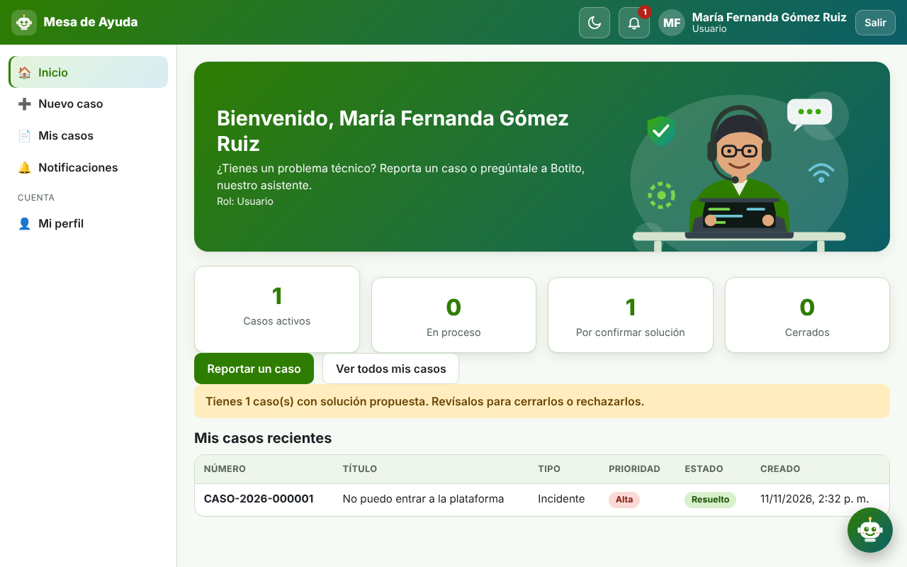
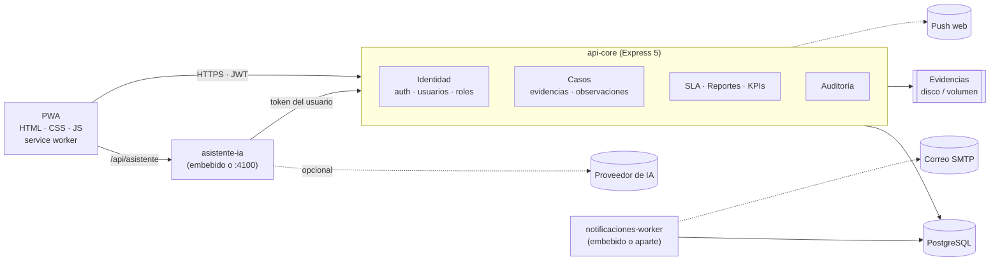
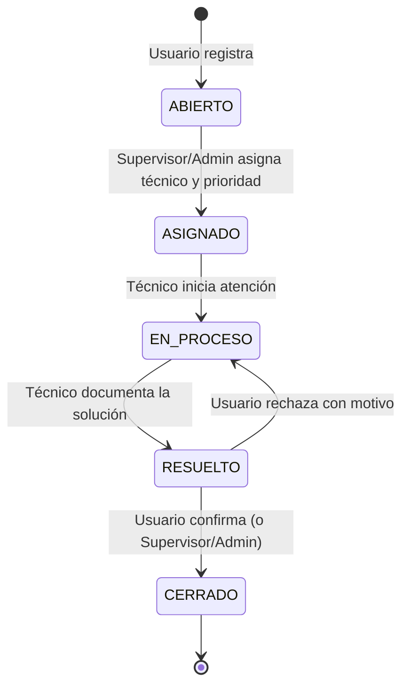

# Plataforma Mesa de Ayuda – SENA

[](https://github.com/crisheap/plataforma-mesa-ayuda/actions/workflows/ci.yml)


-1F5FA8)

Plataforma web para que funcionarios y aprendices **reporten incidentes y solicitudes técnicas**, que la mesa de ayuda los **asigne y resuelva dentro de tiempos acordados (SLA)** y que la entidad **mida la calidad del servicio**. Incluye un asistente virtual, **Botito**, que orienta al usuario paso a paso y, si no logra resolver el problema, le ayuda a crear el caso correctamente.

> Proyecto de grado · Autor: **Cristian Camilo Herrera Aponte** · Noviembre de 2026

<p align="center">
  
</p>

## Contenido

- [Funcionalidades](#funcionalidades)
- [Capturas](#capturas)
- [Arquitectura](#arquitectura)
- [Tecnologías](#tecnologías)
- [Estructura del repositorio](#estructura-del-repositorio)
- [Instalación rápida](#instalación-rápida)
- [Configuración](#configuración)
- [Scripts disponibles](#scripts-disponibles)
- [Pruebas](#pruebas)
- [API](#api)
- [Seguridad](#seguridad)
- [Operación: respaldos, monitoreo y retención](#operación-respaldos-monitoreo-y-retención)
- [Trazabilidad requerimientos → código](#trazabilidad-requerimientos--código)
- [Documentación](#documentación)
- [Límites conocidos y próximos pasos](#límites-conocidos-y-próximos-pasos)

## Funcionalidades

| Rol | Qué puede hacer |
|---|---|
| **Usuario** | Registrar casos con tipo, categoría, número de contacto opcional y evidencias (imágenes, PDF, documentos, video) · ver «Mis casos» con estado, técnico e historial · confirmar o rechazar la solución · calificar la atención de 1 a 5 · conversar con Botito |
| **Técnico** | Panel de casos asignados ordenado por SLA y prioridad · llamar al solicitante desde el detalle del caso · iniciar atención, registrar observaciones (públicas o internas) y marcar como resuelto con la solución |
| **Supervisor** | Ver los casos de su centro · asignar técnico y prioridad (con la carga de cada técnico) · cerrar casos · **dashboard** con gráficas y descarga en Excel · bitácora de auditoría |
| **Administrador de centro** | Gestionar los usuarios, técnicos y supervisores de su centro (crear, editar, bloquear, inactivar) · indicar si el correo de acceso es empresarial o personal y registrar un correo personal · enviar el correo de bienvenida con un enlace para que la persona cree su contraseña · dashboard, Excel y auditoría de su centro |
| **Administrador general** | Cuenta única sin centro (la del seed, `admin@mesaayuda.local`) · crear los **centros de formación** (CEET, CMTC…) y el administrador de cada uno · ver todos los centros, por separado o consolidados · lo común a la entidad: tiempos de SLA, base de conocimiento del asistente y dominios empresariales |

Además, para todos los roles:

- **Correo de bienvenida y activación de la cuenta:** al crear un usuario se envía un mensaje de bienvenida al nuevo sistema con un enlace de un solo uso (vence en 48 h) para que la persona cree su propia contraseña. La contraseña nunca viaja por correo. Si la cuenta tiene correo personal, la bienvenida llega allí; las notificaciones de los casos siguen llegando al correo de acceso.
- **Centros de formación independientes:** cada centro solo ve y gestiona sus usuarios, casos, dashboard, Excel y auditoría; los casos solo se asignan a técnicos del mismo centro, y el administrador general ve todo.
- **Número único de caso** con el código del centro y un consecutivo anual por centro (`CEET-2026-000001`), generado de forma atómica.
- **SLA con semáforo** (en tiempo, en riesgo, vencido) y alertas automáticas al vencer.
- **Notificaciones** en la aplicación (campana con contador), por correo y push web.
- **Aplicación web progresiva (PWA):** instalable en celular y computador, funciona sin conexión y envía los casos redactados offline al volver la red.
- **Tema diurno y nocturno** sin destello al cargar, con contraste WCAG 2.2 AA.
- **Nombre completo y rol** del usuario en el encabezado y en la bienvenida.
- **Dashboard** para el Supervisor y el Administrador: total de casos, por realizar, en proceso, realizados y vencidos; gráfica de casos creados frente a realizados; carga de cada técnico; cumplimiento de SLA y satisfacción. Cada gráfica tiene su tabla de datos y se puede recorrer con el teclado.
- **Reportes en Excel** filtrables por fecha, técnico y prioridad, con una hoja **Dashboard** que resume lo mismo que la pantalla.
- **Bitácora de auditoría inmutable**, protegida por un trigger de PostgreSQL.

## Capturas

| Inicio de sesión | Detalle de un caso (modo nocturno) | Asistente Botito |
|---|---|---|
|  |  |  |

## Arquitectura

Monolito modular con dos servicios satélite (ADR-001 del documento técnico). El asistente y el worker pueden correr **dentro** de la API (modo por defecto, más simple) o como **unidades independientes**.



Cada módulo sigue el patrón **rutas → validación (Zod) → servicio → Prisma**, y las reglas de negocio puras (máquina de estados del caso, control de propiedad, SLA) están en `backend/src/core/`, lo que permite probarlas sin base de datos.

**Ciclo de vida de un caso**



## Tecnologías

| Capa | Tecnología |
|---|---|
| API | Node.js 22 LTS · Express 5 · TypeScript (strict) · Zod |
| Datos | PostgreSQL 15+ · Prisma 7 (adaptador `pg`) |
| Seguridad | JWT de acceso corto + token de refresco revocable · bcrypt (costo 12) · CSP estricta · límite de peticiones |
| Archivos y reportes | Multer (validación de tipo, tamaño y firma) · ExcelJS |
| Frontend | PWA en JavaScript nativo, sin dependencias ni compilación · Service Worker · IndexedDB |
| Opcionales | Nodemailer (correo) · web-push (notificaciones) · API de un modelo de lenguaje para Botito |
| Despliegue | Docker y Docker Compose · respaldos con `pg_dump` |
| Calidad | Biome (análisis estático y formato) · Playwright + axe-core · k6 · Lighthouse · contrato OpenAPI con Swagger UI |

## Estructura del repositorio

```
.
├─ backend/
│  ├─ prisma/            schema.prisma, migraciones (inicial + v2) y seed
│  ├─ integracion/       pruebas de integración contra PostgreSQL
│  ├─ e2e/               accesibilidad (axe) y comportamiento PWA con Playwright
│  └─ src/
│     ├─ core/           reglas puras: estados, SLA, auditoría, notificaciones, correo, push, observabilidad
│     ├─ middlewares/    autenticación, roles, seguridad, límite de peticiones, errores
│     ├─ modules/        auth · usuarios · roles · casos · sla · reportes · auditoria · notificaciones · asistente
│     ├─ docs/           contrato OpenAPI (/api/openapi.json y /api/docs)
│     ├─ jobs/           tareas periódicas: correos, alertas de SLA y retención de Botito
│     ├─ asistente/      punto de entrada del asistente como servicio aparte
│     ├─ worker/         punto de entrada del worker como servicio aparte
│     ├─ app.ts          configuración de Express
│     └─ server.ts       arranque de la API
├─ frontend/             PWA: index.html, sw.js, manifest, css/, js/ (vistas, API, tema, bot), icons/
├─ carga/                prueba de carga (k6) y preparación de datos de prueba
├─ scripts/              respaldo y restauración de la base de datos y las evidencias
├─ docs/                 ERS, manuales de instalación y de usuario, capturas
├─ .github/workflows/    integración continua y mantenimiento (lockfile y formato)
├─ biome.json            reglas de análisis estático y formato
├─ lighthouserc.json     umbrales de Lighthouse
├─ docker-compose.yml
└─ .env.docker.example
```

## Instalación rápida

**Requisitos:** Node.js 22 LTS, npm y PostgreSQL 15 o superior.

```bash
# 1. Crear la base de datos vacía
psql -U postgres -c "CREATE DATABASE mesa_ayuda;"

# 2. Configurar y preparar el backend
cd backend
cp .env.example .env            # en Windows: copy .env.example .env
#    Edita .env: DATABASE_URL, JWT_SECRET y ADMIN_INITIAL_PASSWORD
npm ci                          # instala exactamente las versiones de package-lock.json
npm run prisma:generate         # genera el cliente de Prisma
npm run prisma:migrate          # crea las tablas
npm run db:seed                 # roles, administrador, SLA y base de conocimiento

# 3. Encender
npm run dev                     # API + PWA en http://localhost:4000
```

Ingresa con `admin@mesaayuda.local` y la contraseña de `ADMIN_INITIAL_PASSWORD`. Si la dejaste vacía, el seed genera una aleatoria y la muestra **una sola vez**. El sistema obliga a cambiarla en el primer ingreso. Después crea técnicos, supervisores y usuarios desde **Usuarios**.

Para generar un `JWT_SECRET` seguro:

```bash
node -e "console.log(require('crypto').randomBytes(48).toString('hex'))"
```

> 📘 ¿Primera vez instalando un proyecto así? El [Manual de instalación](docs/Manual_de_Instalacion_Mesa_de_Ayuda_v2.2.docx) explica cada paso para Windows, macOS y Linux, con un recorrido de prueba y una tabla de solución de problemas.

### Con Docker

```bash
cp .env.docker.example .env     # define POSTGRES_PASSWORD, JWT_SECRET y ADMIN_INITIAL_PASSWORD
docker compose up --build       # base de datos + migraciones + API en http://localhost:4000

# Asistente y worker como servicios independientes:
docker compose --profile microservicios up --build
```

En el perfil `microservicios`, pon `EMBED_ASISTENTE=false` y `RUN_WORKER=false` en `.env`, y enruta `/api/asistente` al puerto 4100 desde el proxy.

## Configuración

Variables principales de `backend/.env` (la lista completa y comentada está en [`backend/.env.example`](backend/.env.example)):

| Variable | Obligatoria | Descripción |
|---|---|---|
| `DATABASE_URL` | Sí | Conexión a PostgreSQL. Los símbolos de la contraseña deben ir codificados (`@` → `%40`, `#` → `%23`). |
| `JWT_SECRET` | Sí | Secreto de firma; mínimo 32 caracteres en producción. |
| `ADMIN_INITIAL_PASSWORD` | No | Contraseña temporal del administrador inicial (10+ caracteres con mayúscula, minúscula, número y símbolo). |
| `CORS_ORIGINS` | En producción | Orígenes permitidos, separados por coma. |
| `JWT_EXPIRES_IN` · `REFRESH_TOKEN_DAYS` | No | Vigencia del token de acceso (15 min) y del de refresco (7 días). |
| `UPLOAD_DIR` · `MAX_UPLOAD_MB` | No | Carpeta y tamaño máximo de evidencias (10 MB). |
| `SMTP_*` | No | Correo real. Sin `SMTP_HOST`, los correos se escriben en la consola y el administrador ve el enlace de activación en pantalla. |
| `APP_URL` | En producción | Dirección pública de la plataforma con la que se arman los enlaces de los correos (por defecto `http://localhost:PORT`). |
| `ACCESO_VIGENCIA_HORAS` | No | Horas de vigencia del enlace de activación o restablecimiento (48). |
| `DOMINIOS_EMPRESARIALES` | No | Dominios iniciales que se consideran empresariales (`sena.edu.co,misena.edu.co`). Luego se cambian desde **Configuración**. |
| `VAPID_*` | No | Notificaciones push (`npx web-push generate-vapid-keys`). |
| `IA_PROVIDER` · `IA_API_KEY` · `IA_MODEL` | No | `local` (por defecto) responde con la base de conocimiento, sin servicios externos; `anthropic` usa un modelo de lenguaje. |
| `EMBED_ASISTENTE` · `RUN_WORKER` | No | `true` por defecto: el asistente y el worker corren dentro de la API. |
| `ASISTENTE_RETENCION_DIAS` | No | Días sin actividad tras los cuales se borran las conversaciones de Botito (180; `0` = no borrar). |
| `LOG_PETICIONES` · `METRICS_TOKEN` | No | Registro por petición (`json`, `texto` o `no`) y token para leer `/api/metrics`. |
| `RATE_LIMIT_API_MIN` | No | Peticiones por minuto y por IP a `/api` (600). |
| `RESPALDO_CADA_HORAS` · `RESPALDO_CONSERVAR_DIAS` | No | Frecuencia (24 h) y conservación (14 días) de los respaldos con Docker. |

## Scripts disponibles

Se ejecutan dentro de `backend/`.

| Comando | Para qué sirve |
|---|---|
| `npm run dev` | API + PWA en modo desarrollo, con recarga automática |
| `npm run build` · `npm start` | Compilar a `dist/` y ejecutar en producción |
| `npm run start:asistente` · `npm run start:worker` | Asistente IA y worker como servicios independientes |
| `npm run prisma:generate` | Generar el cliente de Prisma |
| `npm run prisma:migrate` | Aplicar migraciones (`prisma migrate deploy`) |
| `npm run db:seed` | Cargar datos iniciales |
| `npm run db:reiniciar` | Borrar todos los datos, recrear las tablas y volver a cargar los datos iniciales (solo en desarrollo) |
| `npm run prisma:studio` | Explorador visual de la base de datos |
| `npm run typecheck` · `npm test` | Verificar tipos y ejecutar las pruebas unitarias |
| `npm run test:integracion` | Flujo completo contra PostgreSQL (usa una base de datos vacía de prueba) |
| `npm run test:e2e` | Accesibilidad y PWA con Playwright (aplicación encendida; requiere `npx playwright install`) |
| `npm run check` · `npm run fix` | Revisar o aplicar el análisis estático y el formato con Biome |

Para comprobar que el servidor está sano: `http://localhost:4000/api/health?deep=1` debe responder `"db": "ok"`.

## Pruebas

```bash
cd backend
npm run typecheck
npm run check             # Biome: análisis estático y formato
npm test                  # unitarias, capa HTTP y contrato OpenAPI, sin base de datos
npm run test:integracion  # flujo completo contra PostgreSQL
npm run test:e2e          # accesibilidad y PWA con Playwright (aplicación encendida)
```

**Unitarias y HTTP** (`node:test`, sin base de datos):

- **Reglas de negocio:** transiciones de estado del caso, control de propiedad, número de caso.
- **SLA:** cálculo de vencimiento y semáforo; fecha de corte de la retención de Botito.
- **Seguridad:** política de contraseñas, límite de peticiones, firmas de archivos subidos.
- **Asistente:** búsqueda en la base de conocimiento, enmascarado de datos sensibles (conservando el número de caso), clasificación del problema.
- **Capa HTTP** (con base de datos simulada): validación, autenticación, autorización por rol, bloqueo de cuenta, cambio obligatorio de contraseña, cabeceras de seguridad, CORS, documentación de la API y métricas.
- **Contrato:** cada ruta declarada en el código está en el OpenAPI, y el OpenAPI no documenta rutas inexistentes.

**Integración** (base de datos real, migrada y con el seed): recorre el flujo del manual con los cuatro roles. Cubre el cambio obligatorio de contraseña, la creación de usuarios, el registro con evidencias válidas e inválidas, el control de propiedad, la asignación con SLA, la atención con notas internas, el rechazo, el cierre y la calificación. También verifica el historial, las notificaciones, los reportes, la auditoría inmutable (trigger), el bloqueo manual, los permisos de SLA, el asistente y la retención de conversaciones. Usa una base de datos vacía: las pruebas crean usuarios y casos y necesitan el mismo `ADMIN_INITIAL_PASSWORD` del seed.

**Integración continua (GitHub Actions)**, en cada `push` y pull request:

| Trabajo | Qué verifica |
|---|---|
| Tipos y pruebas unitarias | `npm ci`, `prisma generate`, `typecheck`, Biome y `npm test` |
| Integración con PostgreSQL | Servicio `postgres:16`, migraciones, seed y `npm run test:integracion` |
| Docker, respaldos, carga, accesibilidad y Lighthouse | Levanta la aplicación con Docker Compose y comprueba salud, PWA, inicio de sesión y `/api/docs`; hace un respaldo y lo restaura en otra base; ejecuta una prueba de carga con k6 (25 usuarios virtuales, p95 ≤ 3 s y menos de 1 % de errores); revisa las métricas; recorre las pantallas de los cuatro roles con axe (WCAG 2.2 AA, temas claro y oscuro, escritorio y celular), verifica el service worker y el uso sin conexión, y audita con Lighthouse (accesibilidad y buenas prácticas ≥ 90) |

Los reportes de Playwright, Lighthouse, k6 y las métricas quedan como artefacto **reportes-calidad** de cada ejecución.

El workflow **Mantenimiento** (pestaña *Actions*, ejecución manual) regenera `package-lock.json` o aplica el formato de Biome.

## API

La documentación navegable está en **`/api/docs`** (Swagger UI) y el contrato en **`/api/openapi.json`** (OpenAPI 3.1). Todas las respuestas usan el formato `{ success, message?, data? }`. Los errores devuelven `{ success: false, message, errors? }`. Excepto `login`, `refresh`, `logout`, `acceso/verificar`, `acceso/activar`, `health`, `openapi.json` y `docs`, las rutas exigen `Authorization: Bearer <token>`.

| Recurso | Rutas principales |
|---|---|
| Autenticación | `POST /api/auth/login` · `POST /refresh` · `POST /logout` · `GET /me` · `PATCH /password` · `PATCH /tema` · `POST /acceso/verificar` · `POST /acceso/activar` |
| Usuarios | `GET/POST /api/usuarios` · `GET/PATCH /:id` · `PATCH /:id/estado` · `PATCH /:id/restablecer-password` · `POST /:id/enviar-acceso` · `GET /tecnicos` |
| Configuración | `GET/PUT /api/configuracion/correo` (dominios empresariales; los cambia solo el administrador general) |
| Centros | `GET /api/centros` · `POST /api/centros` · `PATCH /api/centros/:id` (crear y editar: solo el administrador general) |
| Casos | `POST /api/casos` · `GET /` · `GET /mis-casos` · `GET /asignados` · `GET /por-numero/:numero` · `GET /:id` · `GET /:id/historial` |
| Atención | `PATCH /api/casos/:id/asignar` · `PATCH /:id/prioridad` · `PATCH /:id/estado` · `GET/POST /:id/observaciones` · `POST /:id/calificacion` |
| Evidencias | `GET/POST /api/casos/:id/evidencias` · `GET /:id/evidencias/:evidenciaId/descargar` |
| SLA, reportes y auditoría | `GET/PUT /api/sla` · `GET /api/reportes/kpis` · `GET /api/reportes/casos.xlsx` · `GET /api/auditoria` |
| Notificaciones | `GET /api/notificaciones` · `PATCH /:id/leida` · `PATCH /leer-todas` · `GET /api/push/clave-publica` · `POST /api/push/suscripciones` |
| Asistente | `POST /api/asistente/conversaciones` · `POST /:id/mensajes` · `PATCH /:id/mensajes/:mid/util` · `POST /sugerencia-caso` · `GET/POST/PATCH /conocimiento` |
| Sistema | `GET /api/health` (`?deep=1` verifica la base de datos) · `GET /api/openapi.json` · `GET /api/docs` · `GET /api/metrics` (con `METRICS_TOKEN`) |

## Seguridad

- **Control de propiedad:** un usuario solo ve sus casos y un técnico solo los asignados. Un caso ajeno responde 404 para no revelar que existe.
- **Bloqueo de cuenta** tras 3 intentos fallidos (15 minutos). El bloqueo manual del administrador surte efecto de inmediato, incluso con sesiones abiertas.
- **Contraseña temporal obligatoria de cambiar:** mientras no se cambie, la API solo permite ver el perfil, cambiar la contraseña y cerrar sesión.
- **Sesiones:** token de acceso de 15 minutos y token de refresco rotativo y revocable. Al cambiar la contraseña o bloquear la cuenta se cierran todas las sesiones.
- **Evidencias:** se validan tipo, extensión, tamaño y la firma real del archivo; la descarga verifica permisos.
- **Asistente:** consulta los casos con el token del propio usuario, enmascara datos sensibles, nunca pide contraseñas y filtra correos ajenos en sus respuestas.
- **Cabeceras:** CSP estricta, `X-Frame-Options`, `nosniff`, HSTS en producción y CORS restringido.
- **Secretos:** ningún `.env` real se versiona; solo las plantillas `.env.example` y `.env.docker.example`.
- **Accesibilidad:** las pantallas de los cuatro roles se revisan con axe en cada cambio; no se aceptan violaciones graves ni críticas de WCAG 2.2 AA.

## Operación: respaldos, monitoreo y retención

**Respaldos (RNF-08).** El perfil `respaldos` de Docker Compose guarda la base de datos (`pg_dump`, formato *custom*) y las evidencias en la carpeta `respaldos/` cada 24 horas y conserva 14 días. La integración continua comprueba en cada cambio que un respaldo se restaura correctamente.

```bash
docker compose --profile respaldos up -d                                            # respaldos programados
docker compose --profile respaldos run --rm -e RESPALDO_UNA_VEZ=true respaldos      # respaldo inmediato
docker compose stop api                                                             # restaurar
docker compose --profile respaldos run --rm --entrypoint sh respaldos /scripts/restaurar.sh /respaldos/ARCHIVO.dump
docker compose start api
```

Copia la carpeta `respaldos/` fuera del servidor (otro disco o la nube).

**Monitoreo (RNF-14).** Cada respuesta lleva `X-Request-Id`. Con `LOG_PETICIONES=json` (por defecto en producción), cada petición se registra en una línea JSON con método, ruta, estado, duración y usuario. `GET /api/metrics`, protegido con `METRICS_TOKEN`, expone en formato Prometheus:

| Métrica | Uso sugerido para alertas |
|---|---|
| `mesa_http_peticiones_total{metodo,ruta,estado}` | Tasa de errores 5xx |
| `mesa_http_duracion_segundos` (histograma) | p95 por ruta mayor de 3 s (RNF-04) |
| `mesa_casos{estado}` · `mesa_casos_sla_vencido` | Casos abiertos y con SLA vencido |
| `mesa_correos_pendientes` | Correos represados (SMTP caído) |
| `mesa_db_disponible` | Base de datos sin respuesta |

**Retención (RF-IA-07, RNF-13).** El worker borra cada 6 horas las conversaciones de Botito sin actividad en los últimos `ASISTENTE_RETENCION_DIAS` días (180 por defecto) y deja el registro en la auditoría. El plazo final debe confirmarlo la entidad según su política de tratamiento de datos.

## Trazabilidad requerimientos → código

| Requerimiento | Implementación |
|---|---|
| RF-CAS-01…04, 11, 13 · Casos, número único, observaciones, calificación | `modules/casos/`, `core/reglas.ts` |
| RF-CAS-14 · Número de contacto del solicitante | `telefonoContacto` en `casos.routes.ts` y migración `20261114230000_telefono_contacto`; `views/caso-nuevo.js` y `views/caso-detalle.js` |
| RF-USU-09 · Tipo de correo y correo personal | `tipoCorreo`, `correoPersonal` en `schema.prisma` y migración `20261115000000_correos_y_acceso`; `core/correos.ts`; `views/admin.js` |
| RF-USU-10 · Bienvenida y enlace de activación | `core/acceso.ts` (tabla `tokens_acceso`), `POST /api/usuarios/:id/enviar-acceso`, `POST /api/auth/acceso/*`; `views/activar.js` |
| RF-ADM-05 · Dominios empresariales | `modules/configuracion/`, `GET/PUT /api/configuracion/correo`; `vistaConfiguracion` en `views/admin.js` |
| RF-CAS-05 · Evidencias | `modules/casos/upload.ts`, `casos.routes.ts` |
| RF-CAS-06/07/10 · Detalle, «mis casos», panel del técnico | `GET /api/casos/:id`, `/mis-casos`, `/asignados` |
| RF-CAS-08/09 · Asignación y prioridad | `PATCH /:id/asignar`, `/:id/prioridad`, `GET /api/usuarios/tecnicos` |
| RF-CAS-12 · Cierre por el usuario | `PATCH /:id/estado`, `core/reglas.ts` |
| RF-NOT-01/02/03 · Notificaciones | `core/notificar.ts`, `jobs/worker.ts`, `modules/notificaciones/` |
| RF-USU-01…08 · Acceso, perfil, usuarios, contraseñas | `modules/auth/`, `modules/usuarios/` |
| RF-ADM-01 · SLA | `modules/sla/`, `core/sla.ts`, `jobs/worker.ts` |
| RF-ADM-02/03 · Reportes Excel y KPIs | `modules/reportes/` |
| RF-CEN-01…04 · Centros de formación | Tabla `centros`, `usuarios.centroId`, `casos.centroId` (migración `20261117000000_centros`); `core/centros.ts`; `modules/centros/`; `views/centros.js`, `centros-ui.js` |
| RF-ADM-06 · Dashboard con gráficas | `GET /api/reportes/kpis` (`resumen`, `tendencia`, `porTecnico`); hoja Dashboard del Excel; `views/dashboard.js`, `graficas.js` |
| RF-ADM-04 · Auditoría inmutable | migración `20261105000000_v2_mejoras`, `modules/auditoria/` |
| RF-PWA-01…06 · PWA | `frontend/manifest.webmanifest`, `sw.js`, `js/pwa.js`, `js/api.js` |
| RF-IA-01…08 · Asistente Botito | `modules/asistente/`, `frontend/js/bot.js` |
| RF-UI-01/02 · Tema diurno y nocturno | `css/styles.css`, `js/theme-init.js`, `js/theme.js` |
| RF-UI-03 · Identidad visual | `css/styles.css` (tokens), `js/illustrations.js` |
| RF-UI-04 · Nombre completo | `usuarioPublico()` en `auth.service.ts`; encabezado y bienvenida |

Los 17 hallazgos del análisis de brechas (H-01 a H-17, sección 10 del ERS) están corregidos en el código. Los más importantes son: control de propiedad de casos (H-05), bloqueo manual efectivo (H-02), restablecimiento de contraseña (H-03), roles de solo lectura (H-04), número de caso atómico (H-12) y ausencia de secretos en el repositorio (H-14).

**Diferencias con el documento técnico**

- El frontend se hizo en JavaScript nativo, sin React, para que funcione sin compilar y con CSP estricta. La arquitectura no cambia: el frontend es independiente y consume la API.
- Los KPIs y el reporte quedaron en `/api/reportes/kpis` y `/api/reportes/casos.xlsx`.
- La sesión usa un token de acceso de 15 minutos más un token de refresco revocable.
- La paleta y la ilustración son una propuesta basada en el verde institucional del SENA. Deben calibrarse con el manual de marca de Betowa; la ilustración es un vector reemplazable (`js/illustrations.js`).

## Documentación

| Documento | Para quién | Contenido |
|---|---|---|
| [ERS y documentación técnica v2.2](docs/Plataforma_Mesa_de_Ayuda_ERS_y_Documentacion_Tecnica_v2.2.docx) | Equipo técnico y evaluadores | Requerimientos con su estado actual, historias de usuario, arquitectura y ADR, UX/UI, UML, manual técnico, hallazgos corregidos, plan por fases y matriz de trazabilidad |
| [Manual de instalación v2.2](docs/Manual_de_Instalacion_Mesa_de_Ayuda_v2.2.docx) | Quien instala la plataforma | Instalación paso a paso, recorrido de prueba, respaldos, documentación de la API, métricas y solución de problemas |
| [Manual de usuario v2.2](docs/Manual_de_Usuario_Mesa_de_Ayuda_v2.2.docx) | Usuarios, técnicos, supervisores y administradores | Cómo reportar bien un caso, seguimiento, Botito y las tareas de cada rol |

Más detalle en [`docs/README.md`](docs/README.md).

## Límites conocidos y próximos pasos

- Las evidencias no se pueden adjuntar sin conexión: el caso se encola y las evidencias se agregan después desde el detalle.
- El limitador de peticiones vive en memoria. Con varias réplicas de la API se necesita un almacén compartido (por ejemplo, Redis).
- Solo una instancia debe ejecutar el worker (`RUN_WORKER=true`).
- El service worker guarda en caché solo `mis-casos`, `asignados` y el detalle de un caso, y la vacía al cerrar sesión. En equipos compartidos hay que cerrar la sesión siempre.
- El envío de SMS (RF-NOT-01) depende de contratar un proveedor.

- La herramienta de análisis estático es Biome y no ESLint: `typescript-eslint` aún no admite TypeScript 7 (exige `typescript < 6.1`).

**Pendientes de operación en producción:** configurar el proxy con TLS, conectar `/api/metrics` a un servidor de monitoreo con alertas, medir la disponibilidad real (RNF-03) y el rendimiento con usuarios reales (RNF-04), y capacitar a los usuarios.

**Pendientes que dependen de terceros:** validar la paleta y la ilustración con el manual de marca de Betowa (RF-UI-03), confirmar el plazo de retención de las conversaciones de Botito (180 días por defecto) y contratar un proveedor de SMS si se requiere (RF-NOT-01).
