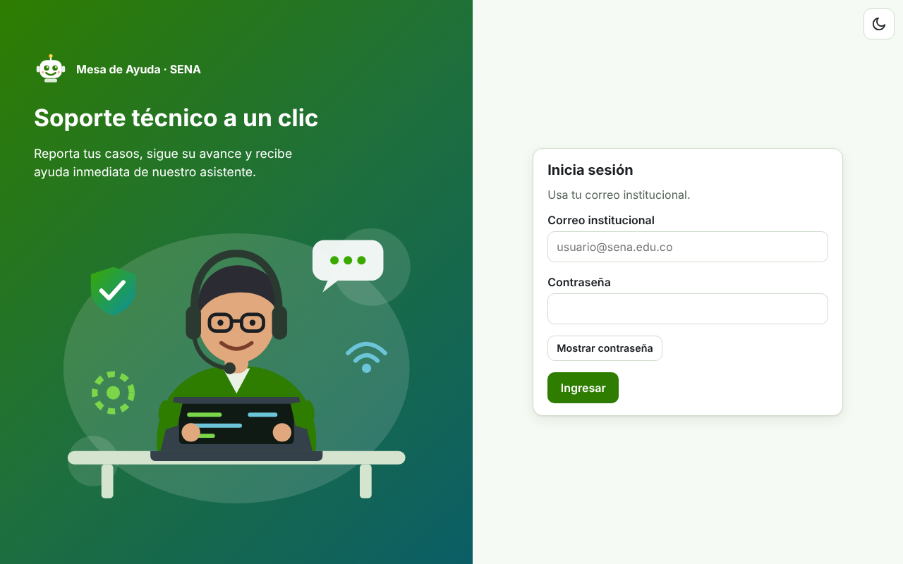
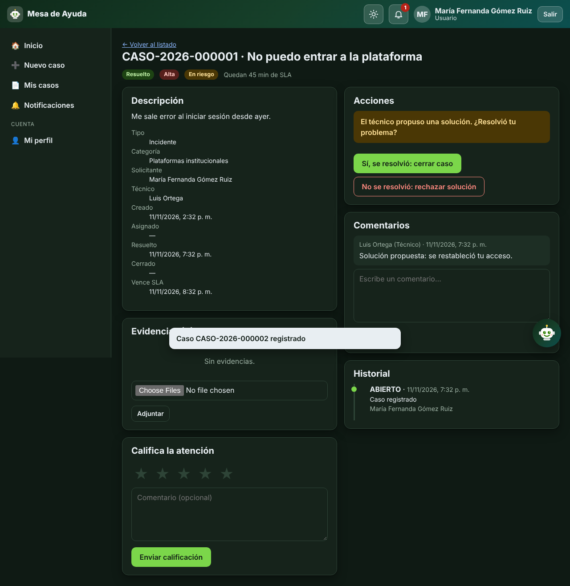
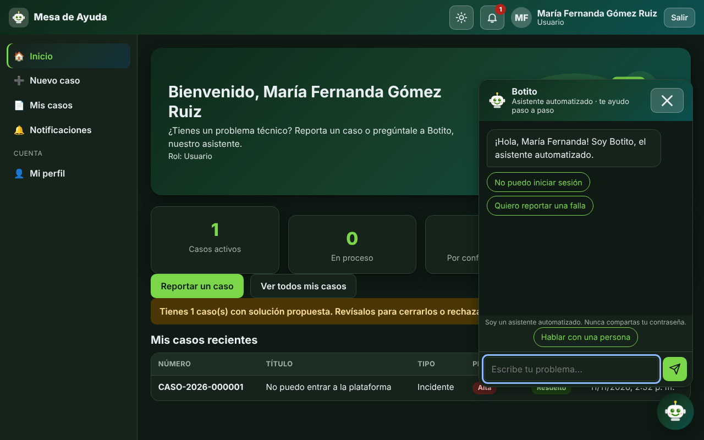
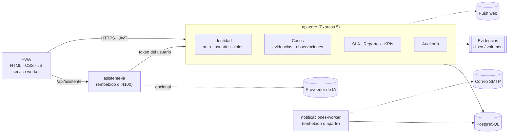
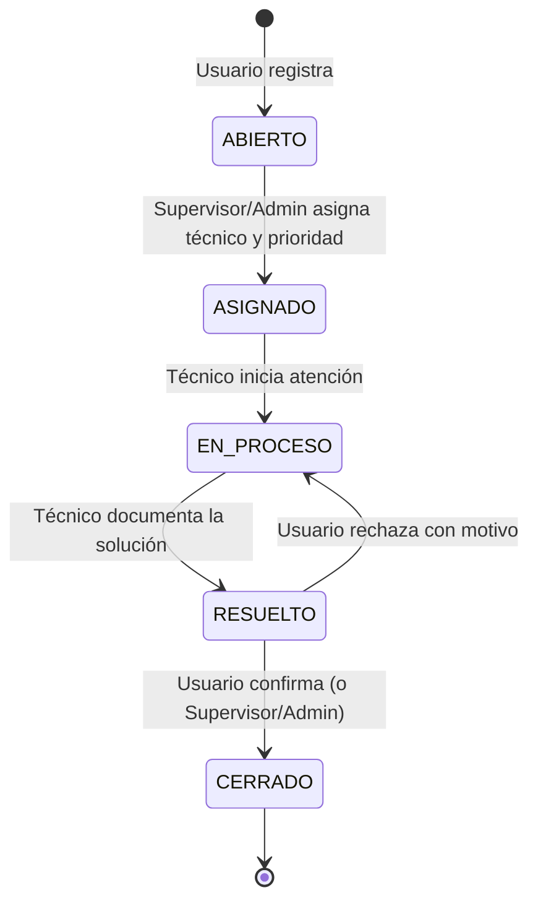

# Plataforma Mesa de Ayuda – SENA

[](https://github.com/crisheap/plataforma-mesa-ayuda/actions/workflows/ci.yml)


Plataforma web para que funcionarios y aprendices **reporten incidentes y solicitudes técnicas**, que la mesa de ayuda los **asigne y resuelva dentro de tiempos acordados (SLA)** y que la entidad **mida la calidad del servicio**. Incluye un asistente virtual, **Botito**, que orienta al usuario paso a paso y, si no logra resolver el problema, le ayuda a crear el caso correctamente.

> Proyecto de grado · Autor: **Cristian Camilo Herrera Aponte** · Noviembre de 2026

<p align="center">
  
</p>

## Contenido

- [Funcionalidades](#funcionalidades)
- [Capturas](#capturas)
- [Arquitectura](#arquitectura)
- [Tecnologías](#tecnologías)
- [Estructura del repositorio](#estructura-del-repositorio)
- [Instalación rápida](#instalación-rápida)
- [Configuración](#configuración)
- [Scripts disponibles](#scripts-disponibles)
- [Pruebas](#pruebas)
- [API](#api)
- [Seguridad](#seguridad)
- [Trazabilidad requerimientos → código](#trazabilidad-requerimientos--código)
- [Documentación](#documentación)
- [Límites conocidos y próximos pasos](#límites-conocidos-y-próximos-pasos)

## Funcionalidades

| Rol | Qué puede hacer |
|---|---|
| **Usuario** | Registrar casos con tipo, categoría y evidencias (imágenes, PDF, documentos, video) · ver «Mis casos» con estado, técnico e historial · confirmar o rechazar la solución · calificar la atención de 1 a 5 · conversar con Botito |
| **Técnico** | Panel de casos asignados ordenado por SLA y prioridad · iniciar atención, registrar observaciones (públicas o internas) y marcar como resuelto con la solución |
| **Supervisor** | Ver todos los casos · asignar técnico y prioridad (con la carga de cada técnico) · cerrar casos · KPIs, reportes y bitácora de auditoría |
| **Administrador** | Gestionar usuarios (crear, editar, bloquear, inactivar) · restablecer contraseñas · configurar tiempos de SLA · administrar la base de conocimiento del asistente |

Además, para todos los roles:

- **Número único de caso** con formato `CASO-AAAA-NNNNNN`, generado de forma atómica.
- **SLA con semáforo** (en tiempo, en riesgo, vencido) y alertas automáticas al vencer.
- **Notificaciones** en la aplicación (campana con contador), por correo y push web.
- **Aplicación web progresiva (PWA):** instalable en celular y computador, funciona sin conexión y envía los casos redactados offline al volver la red.
- **Tema diurno y nocturno** sin destello al cargar, con contraste WCAG 2.2 AA.
- **Nombre completo y rol** del usuario en el encabezado y en la bienvenida.
- **Reportes en Excel** filtrables por fecha, técnico y prioridad.
- **Bitácora de auditoría inmutable**, protegida por un trigger de PostgreSQL.

## Capturas

| Inicio de sesión | Detalle de un caso (modo nocturno) | Asistente Botito |
|---|---|---|
|  |  |  |

## Arquitectura

Monolito modular con dos servicios satélite (ADR-001 del documento técnico). El asistente y el worker pueden correr **dentro** de la API (modo por defecto, más simple) o como **unidades independientes**.



Cada módulo sigue el patrón **rutas → validación (Zod) → servicio → Prisma**, y las reglas de negocio puras (máquina de estados del caso, control de propiedad, SLA) están en `backend/src/core/`, lo que permite probarlas sin base de datos.

**Ciclo de vida de un caso**



## Tecnologías

| Capa | Tecnología |
|---|---|
| API | Node.js 22 LTS · Express 5 · TypeScript (strict) · Zod |
| Datos | PostgreSQL 15+ · Prisma 7 (adaptador `pg`) |
| Seguridad | JWT de acceso corto + token de refresco revocable · bcrypt (costo 12) · CSP estricta · límite de peticiones |
| Archivos y reportes | Multer (validación de tipo, tamaño y firma) · ExcelJS |
| Frontend | PWA en JavaScript nativo, sin dependencias ni compilación · Service Worker · IndexedDB |
| Opcionales | Nodemailer (correo) · web-push (notificaciones) · API de un modelo de lenguaje para Botito |
| Despliegue | Docker y Docker Compose |

## Estructura del repositorio

```
.
├─ backend/
│  ├─ prisma/            schema.prisma, migraciones (inicial + v2) y seed
│  └─ src/
│     ├─ core/           reglas de negocio puras: estados, SLA, auditoría, notificaciones, correo, push
│     ├─ middlewares/    autenticación, roles, seguridad, límite de peticiones, errores
│     ├─ modules/        auth · usuarios · roles · casos · sla · reportes · auditoria · notificaciones · asistente
│     ├─ jobs/           tareas periódicas (correos pendientes y alertas de SLA)
│     ├─ asistente/      punto de entrada del asistente como servicio aparte
│     ├─ worker/         punto de entrada del worker como servicio aparte
│     ├─ app.ts          configuración de Express
│     └─ server.ts       arranque de la API
├─ frontend/             PWA: index.html, sw.js, manifest, css/, js/ (vistas, API, tema, bot), icons/
├─ docs/                 ERS y documentación técnica, manual de instalación, capturas
├─ .github/workflows/    integración continua (tipos y pruebas)
├─ docker-compose.yml
└─ .env.docker.example
```

## Instalación rápida

**Requisitos:** Node.js 22 LTS, npm y PostgreSQL 15 o superior.

```bash
# 1. Crear la base de datos vacía
psql -U postgres -c "CREATE DATABASE mesa_ayuda;"

# 2. Configurar y preparar el backend
cd backend
cp .env.example .env            # en Windows: copy .env.example .env
#    Edita .env: DATABASE_URL, JWT_SECRET y ADMIN_INITIAL_PASSWORD
npm install
npm run prisma:generate         # genera el cliente de Prisma
npm run prisma:migrate          # crea las tablas
npm run db:seed                 # roles, administrador, SLA y base de conocimiento

# 3. Encender
npm run dev                     # API + PWA en http://localhost:4000
```

Ingresa con `admin@mesaayuda.local` y la contraseña de `ADMIN_INITIAL_PASSWORD`. Si la dejaste vacía, el seed genera una aleatoria y la muestra **una sola vez**. El sistema obliga a cambiarla en el primer ingreso. Después crea técnicos, supervisores y usuarios desde **Usuarios**.

Para generar un `JWT_SECRET` seguro:

```bash
node -e "console.log(require('crypto').randomBytes(48).toString('hex'))"
```

> 📘 ¿Primera vez instalando un proyecto así? El [Manual de instalación](docs/Manual_de_Instalacion_Mesa_de_Ayuda_v2.docx) explica cada paso para Windows, macOS y Linux, con un recorrido de prueba y una tabla de solución de problemas.

### Con Docker

```bash
cp .env.docker.example .env     # define POSTGRES_PASSWORD, JWT_SECRET y ADMIN_INITIAL_PASSWORD
docker compose up --build       # base de datos + migraciones + API en http://localhost:4000

# Asistente y worker como servicios independientes:
docker compose --profile microservicios up --build
```

En el perfil `microservicios`, pon `EMBED_ASISTENTE=false` y `RUN_WORKER=false` en `.env`, y enruta `/api/asistente` al puerto 4100 desde el proxy.

## Configuración

Variables principales de `backend/.env` (la lista completa y comentada está en [`backend/.env.example`](backend/.env.example)):

| Variable | Obligatoria | Descripción |
|---|---|---|
| `DATABASE_URL` | Sí | Conexión a PostgreSQL. Los símbolos de la contraseña deben ir codificados (`@` → `%40`, `#` → `%23`). |
| `JWT_SECRET` | Sí | Secreto de firma; mínimo 32 caracteres en producción. |
| `ADMIN_INITIAL_PASSWORD` | No | Contraseña temporal del administrador inicial (10+ caracteres con mayúscula, minúscula, número y símbolo). |
| `CORS_ORIGINS` | En producción | Orígenes permitidos, separados por coma. |
| `JWT_EXPIRES_IN` · `REFRESH_TOKEN_DAYS` | No | Vigencia del token de acceso (15 min) y del de refresco (7 días). |
| `UPLOAD_DIR` · `MAX_UPLOAD_MB` | No | Carpeta y tamaño máximo de evidencias (10 MB). |
| `SMTP_*` | No | Correo real. Sin `SMTP_HOST`, los correos se escriben en la consola. |
| `VAPID_*` | No | Notificaciones push (`npx web-push generate-vapid-keys`). |
| `IA_PROVIDER` · `IA_API_KEY` · `IA_MODEL` | No | `local` (por defecto) responde con la base de conocimiento, sin servicios externos; `anthropic` usa un modelo de lenguaje. |
| `EMBED_ASISTENTE` · `RUN_WORKER` | No | `true` por defecto: el asistente y el worker corren dentro de la API. |

## Scripts disponibles

Se ejecutan dentro de `backend/`.

| Comando | Para qué sirve |
|---|---|
| `npm run dev` | API + PWA en modo desarrollo, con recarga automática |
| `npm run build` · `npm start` | Compilar a `dist/` y ejecutar en producción |
| `npm run start:asistente` · `npm run start:worker` | Asistente IA y worker como servicios independientes |
| `npm run prisma:generate` | Generar el cliente de Prisma |
| `npm run prisma:migrate` | Aplicar migraciones (`prisma migrate deploy`) |
| `npm run db:seed` | Cargar datos iniciales |
| `npm run prisma:studio` | Explorador visual de la base de datos |
| `npm run typecheck` · `npm test` | Verificar tipos y ejecutar las pruebas |

Para comprobar que el servidor está sano: `http://localhost:4000/api/health?deep=1` debe responder `"db": "ok"`.

## Pruebas

```bash
cd backend
npm run typecheck
npm test
```

Son 29 pruebas con el ejecutor nativo de Node (`node:test`). No necesitan base de datos:

- **Reglas de negocio:** transiciones de estado del caso, control de propiedad, número de caso.
- **SLA:** cálculo de vencimiento y semáforo.
- **Seguridad:** política de contraseñas, límite de peticiones, firmas de archivos subidos.
- **Asistente:** búsqueda en la base de conocimiento, enmascarado de datos sensibles, clasificación del problema.
- **Capa HTTP** (con base de datos simulada): validación, autenticación, autorización por rol, bloqueo de cuenta, cambio obligatorio de contraseña, cabeceras de seguridad y CORS.

La integración continua de GitHub Actions ejecuta la verificación de tipos y las pruebas en cada `push` y pull request.

## API

Todas las respuestas usan el formato `{ success, message?, data? }`. Los errores devuelven `{ success: false, message, errors? }`. Excepto `login`, `refresh`, `logout` y `health`, las rutas exigen `Authorization: Bearer <token>`.

| Recurso | Rutas principales |
|---|---|
| Autenticación | `POST /api/auth/login` · `POST /refresh` · `POST /logout` · `GET /me` · `PATCH /password` · `PATCH /tema` |
| Usuarios | `GET/POST /api/usuarios` · `GET/PATCH /:id` · `PATCH /:id/estado` · `PATCH /:id/restablecer-password` · `GET /tecnicos` |
| Casos | `POST /api/casos` · `GET /` · `GET /mis-casos` · `GET /asignados` · `GET /por-numero/:numero` · `GET /:id` · `GET /:id/historial` |
| Atención | `PATCH /api/casos/:id/asignar` · `PATCH /:id/prioridad` · `PATCH /:id/estado` · `GET/POST /:id/observaciones` · `POST /:id/calificacion` |
| Evidencias | `GET/POST /api/casos/:id/evidencias` · `GET /:id/evidencias/:evidenciaId/descargar` |
| SLA, reportes y auditoría | `GET/PUT /api/sla` · `GET /api/reportes/kpis` · `GET /api/reportes/casos.xlsx` · `GET /api/auditoria` |
| Notificaciones | `GET /api/notificaciones` · `PATCH /:id/leida` · `PATCH /leer-todas` · `GET /api/push/clave-publica` · `POST /api/push/suscripciones` |
| Asistente | `POST /api/asistente/conversaciones` · `POST /:id/mensajes` · `PATCH /:id/mensajes/:mid/util` · `POST /sugerencia-caso` · `GET/POST/PATCH /conocimiento` |
| Salud | `GET /api/health` (`?deep=1` verifica la base de datos) |

## Seguridad

- **Control de propiedad:** un usuario solo ve sus casos y un técnico solo los asignados. Un caso ajeno responde 404 para no revelar que existe.
- **Bloqueo de cuenta** tras 3 intentos fallidos (15 minutos). El bloqueo manual del administrador surte efecto de inmediato, incluso con sesiones abiertas.
- **Contraseña temporal obligatoria de cambiar:** mientras no se cambie, la API solo permite ver el perfil, cambiar la contraseña y cerrar sesión.
- **Sesiones:** token de acceso de 15 minutos y token de refresco rotativo y revocable. Al cambiar la contraseña o bloquear la cuenta se cierran todas las sesiones.
- **Evidencias:** se validan tipo, extensión, tamaño y la firma real del archivo; la descarga verifica permisos.
- **Asistente:** consulta los casos con el token del propio usuario, enmascara datos sensibles, nunca pide contraseñas y filtra correos ajenos en sus respuestas.
- **Cabeceras:** CSP estricta, `X-Frame-Options`, `nosniff`, HSTS en producción y CORS restringido.
- **Secretos:** ningún `.env` real se versiona; solo las plantillas `.env.example` y `.env.docker.example`.

## Trazabilidad requerimientos → código

| Requerimiento | Implementación |
|---|---|
| RF-CAS-01…04, 11, 13 · Casos, número único, observaciones, calificación | `modules/casos/`, `core/reglas.ts` |
| RF-CAS-05 · Evidencias | `modules/casos/upload.ts`, `casos.routes.ts` |
| RF-CAS-06/07/10 · Detalle, «mis casos», panel del técnico | `GET /api/casos/:id`, `/mis-casos`, `/asignados` |
| RF-CAS-08/09 · Asignación y prioridad | `PATCH /:id/asignar`, `/:id/prioridad`, `GET /api/usuarios/tecnicos` |
| RF-CAS-12 · Cierre por el usuario | `PATCH /:id/estado`, `core/reglas.ts` |
| RF-NOT-01/02/03 · Notificaciones | `core/notificar.ts`, `jobs/worker.ts`, `modules/notificaciones/` |
| RF-USU-01…08 · Acceso, perfil, usuarios, contraseñas | `modules/auth/`, `modules/usuarios/` |
| RF-ADM-01 · SLA | `modules/sla/`, `core/sla.ts`, `jobs/worker.ts` |
| RF-ADM-02/03 · Reportes Excel y KPIs | `modules/reportes/` |
| RF-ADM-04 · Auditoría inmutable | migración `20261105000000_v2_mejoras`, `modules/auditoria/` |
| RF-PWA-01…06 · PWA | `frontend/manifest.webmanifest`, `sw.js`, `js/pwa.js`, `js/api.js` |
| RF-IA-01…08 · Asistente Botito | `modules/asistente/`, `frontend/js/bot.js` |
| RF-UI-01/02 · Tema diurno y nocturno | `css/styles.css`, `js/theme-init.js`, `js/theme.js` |
| RF-UI-03 · Identidad visual | `css/styles.css` (tokens), `js/illustrations.js` |
| RF-UI-04 · Nombre completo | `usuarioPublico()` en `auth.service.ts`; encabezado y bienvenida |

Los 17 hallazgos del análisis de brechas (H-01 a H-17, sección 10 del ERS) están corregidos en el código. Los más importantes son: control de propiedad de casos (H-05), bloqueo manual efectivo (H-02), restablecimiento de contraseña (H-03), roles de solo lectura (H-04), número de caso atómico (H-12) y ausencia de secretos en el repositorio (H-14).

**Diferencias con el documento técnico**

- El frontend se hizo en JavaScript nativo, sin React, para que funcione sin compilar y con CSP estricta. La arquitectura no cambia: el frontend es independiente y consume la API.
- Los KPIs y el reporte quedaron en `/api/reportes/kpis` y `/api/reportes/casos.xlsx`.
- La sesión usa un token de acceso de 15 minutos más un token de refresco revocable.
- La paleta y la ilustración son una propuesta basada en el verde institucional del SENA. Deben calibrarse con el manual de marca de Betowa; la ilustración es un vector reemplazable (`js/illustrations.js`).

## Documentación

| Documento | Contenido |
|---|---|
| [ERS y documentación técnica v2](docs/Plataforma_Mesa_de_Ayuda_ERS_y_Documentacion_Tecnica_v2.docx) | Requerimientos, historias de usuario, arquitectura y ADR, UX/UI, UML, manual técnico y análisis de brechas |
| [Manual de instalación v2](docs/Manual_de_Instalacion_Mesa_de_Ayuda_v2.docx) | Instalación paso a paso, recorrido de prueba y solución de problemas |

Las columnas de estado del ERS describen el diagnóstico **anterior** a la versión 2.0; el estado actual es el de la tabla de trazabilidad de arriba. Más detalle en [`docs/README.md`](docs/README.md).

## Límites conocidos y próximos pasos

- Las evidencias no se pueden adjuntar sin conexión: el caso se encola y las evidencias se agregan después desde el detalle.
- El limitador de peticiones vive en memoria. Con varias réplicas de la API se necesita un almacén compartido (por ejemplo, Redis).
- Solo una instancia debe ejecutar el worker (`RUN_WORKER=true`).
- El service worker guarda en caché solo `mis-casos`, `asignados` y el detalle de un caso, y la vacía al cerrar sesión. En equipos compartidos hay que cerrar la sesión siempre.
- La configuración de Docker es de referencia y aún no se ha probado en un entorno real.
- Pendiente: versionar `package-lock.json` para instalaciones reproducibles, pruebas de integración contra PostgreSQL, manual de usuario por rol y validación de la identidad visual con el SENA.
